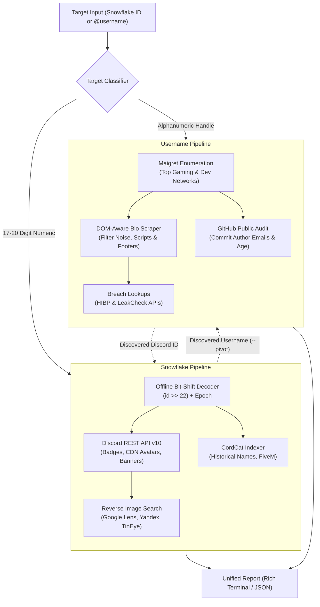
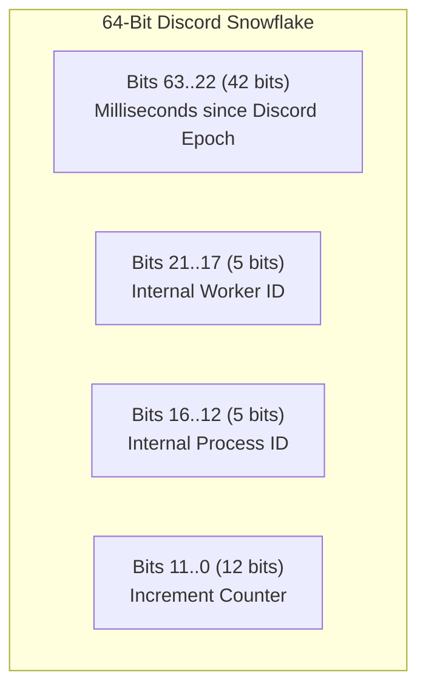

<div align="center">


[](LICENSE)
[](https://www.python.org/)
[](tests/)
[]()

[Features](#key-features) • [Architecture](#architecture) • [Current Capabilities & Roadmap](#current-capabilities--roadmap) • [Installation](#installation) • [Usage](#usage) • [Configuration](#configuration) • [Documentation](docs/)

</div>

---

**Argus** is a fast, modular Python OSINT command-line tool built to pivot between 64-bit Discord Snowflake IDs and cross-platform username handles. It decodes public Discord metadata, parses profile biographies for leaked contact details, and chains discovered leads through breach lookup and transparency APIs.

---

## Key Features

- **Smart Target Classification**: Automatically distinguishes between a numeric 17–20 digit Discord Snowflake ID and an alphanumeric username handle (`@username`), dispatching the appropriate investigation pipeline.
- **Offline Snowflake Math**: Decodes 64-bit Discord Snowflake IDs into millisecond UTC timestamps, account age, internal worker IDs, process IDs, and increment numbers with zero network overhead.
- **Discord REST API v10**: Queries user profile metadata, resolves global display names, constructs full-resolution (1024px) CDN avatar/banner links, and translates `public_flags` bitmasks into badge titles.
- **Reverse Image Search Generation**: Automatically constructs direct query URLs for avatar images across Google Lens, Yandex Visual, TinEye, and Bing Visual Search.
- **Cross-Platform Username Sweep**: Integrates Maigret to locate accounts across gaming, developer, and social networks.
- **DOM-Aware Bio Parsing**: Decomposes page scripts, stylesheets, navigation bars, and footers with BeautifulSoup before extraction, ensuring that personal tags and emails are parsed without capturing site chrome or CDN version strings.
- **Automated Pivoting**: Automatically bridges between Snowflake IDs and discovered usernames. When a username is resolved from a Discord ID, the username pivot can run automatically (`--pivot`).
- **Enrichment Plugins**: Concurrently checks CordCat for historical usernames and FiveM identifiers, verifies email breach exposures via Have I Been Pwned or LeakCheck, and audits public GitHub commit emails.
- **Windows Socket Lifecycle**: Implements custom Windows Proactor event loop handlers to eliminate `WinError 10054` socket reset exceptions during bulk network queries.

---

## Architecture

### Dual-Engine Investigation Flow



### Discord 64-Bit Snowflake Structure



---

## Current Capabilities & Roadmap

| Feature / Module | Status | Notes |
| :--- | :---: | :--- |
| 🔢 **Snowflake Bit-Shift Math** | ✅ Supported | Instant offline calculation: `(id >> 22) + 1420070400000` |
| 🛡️ **Discord User REST API v10** | ✅ Supported | Requires `DISCORD_BOT_TOKEN`; decodes public flags & avatars |
| 🔍 **Avatar Reverse Search Links** | ✅ Supported | Direct query links for Google Lens, Yandex, TinEye, Bing |
| 🌐 **Maigret Username Sweep** | ✅ Supported | Direct library import with subprocess fallback |
| 🧹 **DOM-Aware Bio Scraper** | ✅ Supported | BeautifulSoup decomposition of scripts, styles, and footers |
| 🎯 **Lead False-Positive Filtering** | ✅ Supported | Strict RFC TLD validation and platform domain matching |
| 🐱 **CordCat History Lookup** | ✅ Supported | Historical handles and FiveM IDs via `CORDCAT_API_KEY` |
| 🔓 **Email Breach Checks** | ✅ Supported | HIBP and LeakCheck API integration |
| 🐙 **GitHub Public Event Audit** | ✅ Supported | Extracts public commit author emails and account timeline |
| 📊 **Real-Time Dual Progress Bar** | ✅ Supported | Displays active phase and currently scanned service name |
| 🪟 **Windows Socket Patch** | ✅ Supported | Suppresses Proactor `WinError 10054` socket resets |
| 📄 **JSON Export** | ✅ Supported | Structured Pydantic schema output via `--json` or `--out` |
| 📑 **Self-Contained HTML Reports** | ✅ Supported | Standalone zero-dependency HTML export with `--html` and browser preview `--view` |
| 🔄 **Proxy Support (Tor / SOCKS5 / HTTP)** | ✅ Supported | Configurable `--proxy` / `-x` flag or `ARGUS_PROXY` environment variable |
| 🎮 **Gaming Ecosystem Pivots** | ✅ Supported | Mojang API Minecraft UUID/skin render and Steam Community XML profiling |
| 🪙 **Precision Crypto & Messaging Leads** | ✅ Supported | BTC, ETH (with commit filter), SOL, Telegram, Matrix, and Signal extraction |
| 🛡️ **Hudson Rock Infostealer Intel** | ✅ Supported | Unauthenticated infostealer malware infection & stolen credential analysis |
| 🖼️ **Cross-Platform Avatar Hashing** | ✅ Supported | 64-bit dHash perceptual matching with Hamming distance visual correlation |
| 🎯 **Algorithmic Confidence Scoring** | ✅ Supported | Objective 0–100% target correlation score based on multi-vector evidence |
| 🌐 **Personal Domain Recon & crt.sh** | ✅ Supported | RDAP registrar records and Certificate Transparency subdomain discovery |
| 📦 **Package Registry Footprint** | ✅ Supported | Published package authoring checks across PyPI, npm, and crates.io |
| 🏛️ **Wayback Machine Snapshots** | ✅ Supported | Historical profile snapshot archiving via Internet Archive CDX API |
| 🔑 **Keybase & OpenPGP Verification** | ✅ Supported | Cryptographic proofs and public keys via Keybase & keys.openpgp.org |
| 🕸️ **Interactive D3 Force Graph** | ✅ Supported | Offline zero-dependency physics relationship graph in HTML Dossier |
| 📷 **Avatar EXIF & Metadata** | ✅ Supported | Opt-in `--metadata` / `-M` flag inspecting dimensions, camera, and EXIF tags |
| 📧 **Email Account Probing (Holehe)** | ✅ Supported | Opt-in `--email-sites` / `-E` flag checking 120+ platforms for registered accounts |
| 🔍 **Pre-Computed Google Dorks** | ✅ Supported | Opt-in `--dorks` / `-D` flag generating targeted web/paste/leak search URLs |
| 🌐 **Intelligence X Darknet Search** | ✅ Supported | Opt-in `--intelx` flag for public paste and darknet archive hits |
| 💻 **Interactive Terminal UI (TUI)** | ✅ Supported | Menu-driven terminal report inspection via `argus tui` / `argus explore` |
| ⚙️ **Custom Extraction Patterns** | ⏳ Planned | User-defined regex rules in `~/.argus/patterns/` |

---

## Installation

### Recommended: Global Tool via `uv`

```powershell
git clone https://github.com/Itvus/Argus.git
cd Argus
uv tool install -e .
```

### Alternative: Global Tool via `pipx`

```powershell
pipx install -e .
```

### Local Virtual Environment

```powershell
uv venv .venv
# Windows:
.\.venv\Scripts\activate
# Linux / macOS:
source .venv/bin/activate

uv pip install -e ".[dev]"
```

---

## Configuration

Argus functions without configuration for offline Snowflake decoding, DOM bio parsing, and public username sweeps. Optional API keys enable elevated rate limits and enrichment indexers.

Create a `.env` file in the project directory or at `~/.argus/.env`:

```env
# Discord Bot Token (for Discord REST API profile lookups)
DISCORD_BOT_TOKEN=your_bot_token_here

# CordCat API Key (historical usernames & FiveM lookups)
CORDCAT_API_KEY=your_cordcat_key_here

# Have I Been Pwned API Key (email breach checks)
HIBP_API_KEY=your_hibp_key_here

# LeakCheck API Key (alternative breach checks)
LEAKCHECK_API_KEY=your_leakcheck_key_here

# GitHub Personal Access Token (increases rate limits to 5,000 req/hr)
GITHUB_TOKEN=your_github_pat_here

# Proxy URL (HTTP, HTTPS, or SOCKS5 / Tor)
ARGUS_PROXY=socks5://127.0.0.1:9050
```

Inspect active configuration anytime:
```powershell
argus config
```

---

## Usage

### Smart Scan (`argus scan`)

```powershell
# Scan a Discord Snowflake ID
argus scan 155149108183695360

# Scan a Snowflake ID and automatically pivot into the resolved username handle
argus scan 155149108183695360 --pivot

# Scan an alphanumeric username handle
argus scan torvalds

# Scan across all supported platforms
argus scan target_handle --all-sites

# Set custom HTTP timeout per module (default: 15s)
argus scan target_handle --timeout 25

# Save structured report to a JSON file
argus scan 155149108183695360 --pivot --out report.json

# Save standalone zero-dependency HTML report
argus scan torvalds --html report.html

# Open interactive HTML dossier in browser (creates temporary file if --html omitted)
argus scan 155149108183695360 --pivot --view

# Route requests through a SOCKS5 or Tor proxy
argus scan torvalds --proxy socks5://127.0.0.1:9050

# Probe 120+ platforms for account registrations on discovered emails
argus scan torvalds --email-sites

# Scan an email address directly across 120+ platforms
argus scan target@example.com --email-sites

# Generate pre-computed Google Dorks targeting pastes, documents, and leaks
argus scan torvalds --dorks

# Query Intelligence X darknet archives for target selector
argus scan torvalds --intelx

# Pipe JSON directly into jq
argus scan torvalds --json | jq .pivot_leads
```

### Interactive Terminal Dashboard (`argus tui` / `argus explore`)

```powershell
# Scan target and immediately open interactive TUI explorer
argus tui torvalds

# Open an existing investigation report in the interactive TUI
argus tui --file report.json

# Launch TUI explorer (prompts interactively if no file specified)
argus explore
```

### Dedicated Snowflake Inspection (`argus snowflake`)

```powershell
# Decode snowflake metadata and query API/CordCat
argus snowflake 155149108183695360

# Save decoded metadata to JSON
argus snowflake 155149108183695360 --out snowflake.json

# Save and immediately launch HTML telemetry report in browser
argus snowflake 155149108183695360 --html snowflake.html --view
```

### Manual Page (`argus man`)

```powershell
# View terminal manual
argus man

# Export standard UNIX troff roff format
argus man --roff > argus.1
```

---

## Documentation

- [Architecture & Design](docs/architecture.md): Asynchronous orchestrator, pipeline branching, and Pydantic schema design.
- [Module Reference](docs/modules.md): Technical breakdown of Snowflake math, Discord API flags, DOM bio scrapers, and enrichment indexers.
- [Configuration Guide](docs/configuration.md): Instructions for API keys, precedence rules, and verification.
- [Contributing Guide](CONTRIBUTING.md): Guidelines for local setup, testing, and pull requests.

---

## Legal & Ethical Disclaimer

> [!CAUTION]
> Argus is designed strictly for authorized security assessments, digital forensics, incident response, and open-source intelligence research. It interacts exclusively with publicly accessible endpoints, published profile metadata, and third-party transparency indexers. Users are solely responsible for ensuring compliance with applicable privacy and computer security laws.

---

## License

> [!NOTE]
> This project is licensed under the **GNU Affero General Public License v3.0 (AGPL-3.0)**. See the [LICENSE](LICENSE) file for the full license text.
